<!-- Generated by tools/build.py. Edit that file and run `python3 tools/build.py`. -->
<a name="top"></a>

<p align="center">
  <picture><source media="(prefers-color-scheme: dark)" srcset="assets/dark/hero-es.svg"/></picture>
</p>

<p align="center">
  <a href="https://linkedin.com/in/braian-quintian"></a>
  <a href="mailto:bquintianromero@gmail.com"></a>
  <a href="https://www.instagram.com/braian.qloq/"></a>
  <a href="https://github.com/braqon"></a>
</p>

<p align="center">
  
  <a href="README.md"></a>
  
</p>

<p align="center"><code>braqon@github:~$ cat README.md</code><br/><sub><a href="#whoami">whoami</a> · <a href="#rails">rieles</a> · <a href="#stack">stack</a> · <a href="#projects">proyectos</a> · <a href="#telemetry">telemetría</a> · <a href="#off-keyboard">fuera del teclado</a></sub></p>

<picture><source media="(prefers-color-scheme: dark)" srcset="assets/dark/now-es.svg"/></picture>

<a name="whoami"></a>
<picture><source media="(prefers-color-scheme: dark)" srcset="assets/dark/s01-es.svg"/></picture>

```ts
const braqon = {
  nombre:     "Braian Quintian",
  rol:        "CTO @ 88Pay",
  desde:      "Colombia 🇨🇴",
  construye:  ["APIs de pago", "plataformas fintech"],
  stack:      ["NestJS", "Next.js", "Angular", "TS"],
  infra:      ["AWS", "Terraform", "Docker"],
  aprendiendo:["Java", "Spring Boot", "GraphQL"],
  hobbies:    ["🏀", "🎵", "📚"],
  gasolina:   "☕".repeat(Infinity), // RangeError 💥
};
```

- 💳 De día conecto las formas de pagar en Latinoamérica (transferencias, billeteras, tarjetas, efectivo y cripto) detrás de **una sola API**.
- 🔐 Me importa lo aburrido que mantiene el dinero seguro: código seguro por defecto, mínimo privilegio y revisiones que de verdad se hacen.
- 🎓 Estudiante de Ingeniería de Sistemas. Aprendiendo en voz alta.
- 📫 Escríbeme a **bquintianromero@gmail.com**

<a name="rails"></a>
<picture><source media="(prefers-color-scheme: dark)" srcset="assets/dark/s02-es.svg"/></picture>

<picture><source media="(prefers-color-scheme: dark)" srcset="assets/dark/rails-es.svg"/></picture>

<p align="center"><sub>Los tipos de rieles de pago para los que construyo integraciones. El mismo contrato arriba, casos borde muy distintos abajo.</sub></p>

<a name="stack"></a>
<picture><source media="(prefers-color-scheme: dark)" srcset="assets/dark/s03-es.svg"/></picture>

<table align="center">
  <tr><td align="center" width="170"><b>🎨 Frontend</b></td><td></td></tr>
  <tr><td align="center" width="170"><b>⚙️ Backend</b></td><td></td></tr>
  <tr><td align="center" width="170"><b>🗄️ Datos</b></td><td></td></tr>
  <tr><td align="center" width="170"><b>☁️ Cloud y herramientas</b></td><td></td></tr>
  <tr><td align="center" width="170"><b>📚 Aprendiendo</b></td><td></td></tr>
</table>

<a name="projects"></a>
<picture><source media="(prefers-color-scheme: dark)" srcset="assets/dark/s04-es.svg"/></picture>

<a href="https://github.com/braqon-dev/express-version-api"><picture><source media="(prefers-color-scheme: dark)" srcset="assets/dark/project-es.svg"/></picture></a>

<a name="telemetry"></a>
<picture><source media="(prefers-color-scheme: dark)" srcset="assets/dark/s05-es.svg"/></picture>

<p align="center">
  <picture><source media="(prefers-color-scheme: dark)" srcset="https://github-profile-summary-cards.vercel.app/api/cards/profile-details?username=braqon&theme=github_dark"/></picture>
</p>
<p align="center">
  <picture><source media="(prefers-color-scheme: dark)" srcset="https://github-profile-summary-cards.vercel.app/api/cards/stats?username=braqon&theme=github_dark"/></picture>
  <picture><source media="(prefers-color-scheme: dark)" srcset="https://github-profile-summary-cards.vercel.app/api/cards/most-commit-language?username=braqon&theme=github_dark"/></picture>
</p>
<p align="center">
  <picture><source media="(prefers-color-scheme: dark)" srcset="https://streak-stats.demolab.com?user=braqon&hide_border=true&theme=github-dark-blue"/></picture>
  <picture><source media="(prefers-color-scheme: dark)" srcset="https://github-profile-summary-cards.vercel.app/api/cards/productive-time?username=braqon&theme=github_dark&utcOffset=-5"/></picture>
</p>
<p align="center">
  <picture><source media="(prefers-color-scheme: dark)" srcset="https://raw.githubusercontent.com/braqon/braqon/output/github-snake-dark.svg"/></picture>
  <br/><sub>🐍 una serpiente comiéndose mis contribuciones, se actualiza cada 12 horas</sub>
</p>

<a name="off-keyboard"></a>
<picture><source media="(prefers-color-scheme: dark)" srcset="assets/dark/s06-es.svg"/></picture>

<details>
  <summary><b>🎲 Datos random (dale clic)</b></summary>
  <br/>

  - 🏷️ **BRAQON** = **BRA**ian + **Q**uintian + **ON**. Sí, hice la cuenta.
  - 🐛 Mi bug favorito es el que solo pasa en producción. (Es broma. Por favor no.)
  - 🎮 En los juegos soy *baxtom* o *braxtom*, el que esté libre.
  - 🏀 Si no estoy programando, probablemente estoy discutiendo de basket.
</details>

<p align="center"><b>🎧 Programando con</b><br/>
  <a href="https://spotify-github-profile.kittinanx.com/api/view?uid=31s5hjyn255z2to7qh4jy7f3lsve&redirect=true"></a>
</p>

<p align="center">
  
</p>

<picture><source media="(prefers-color-scheme: dark)" srcset="assets/dark/footer-es.svg"/></picture>

<p align="center"><sub><a href="#top">volver arriba ↑</a></sub></p>
