<!-- Generated by tools/build.py. Edit that file and run `python3 tools/build.py`. -->
<a name="top"></a>

<p align="center">
  <picture><source media="(prefers-color-scheme: dark)" srcset="assets/dark/hero-en.svg"/></picture>
</p>

<p align="center">
  <a href="https://linkedin.com/in/braian-quintian"></a>
  <a href="mailto:bquintianromero@gmail.com"></a>
  <a href="https://www.instagram.com/braian.qloq/"></a>
  <a href="https://github.com/braqon"></a>
</p>

<p align="center">
  
  <a href="README.es.md"></a>
  
</p>

<p align="center"><code>braqon@github:~$ cat README.md</code><br/><sub><a href="#whoami">whoami</a> · <a href="#rails">rails</a> · <a href="#stack">stack</a> · <a href="#projects">projects</a> · <a href="#telemetry">telemetry</a> · <a href="#off-keyboard">off-keyboard</a></sub></p>

<picture><source media="(prefers-color-scheme: dark)" srcset="assets/dark/now-en.svg"/></picture>

<a name="whoami"></a>
<picture><source media="(prefers-color-scheme: dark)" srcset="assets/dark/s01-en.svg"/></picture>

```ts
const braqon = {
  name:     "Braian Quintian",
  role:     "CTO @ 88Pay",
  based:    "Colombia 🇨🇴",
  builds:   ["payment APIs", "fintech platforms"],
  stack:    ["NestJS", "Next.js", "Angular", "TS"],
  infra:    ["AWS", "Terraform", "Docker"],
  learning: ["Java", "Spring Boot", "GraphQL"],
  hobbies:  ["🏀", "🎵", "📚"],
  fuel:     "☕".repeat(Infinity), // RangeError 💥
};
```

- 💳 By day I wire up the ways Latin America pays (bank transfers, wallets, cards, cash and crypto) behind **one API**.
- 🔐 I care about the boring stuff that keeps money safe: secure-by-default code, least privilege and reviews that actually happen.
- 🎓 Systems Engineering student. Learning out loud.
- 📫 Reach me at **bquintianromero@gmail.com**

<a name="rails"></a>
<picture><source media="(prefers-color-scheme: dark)" srcset="assets/dark/s02-en.svg"/></picture>

<picture><source media="(prefers-color-scheme: dark)" srcset="assets/dark/rails-en.svg"/></picture>

<p align="center"><sub>The kinds of payment rails I build integrations for. Same contract on top, wildly different edge cases underneath.</sub></p>

<a name="stack"></a>
<picture><source media="(prefers-color-scheme: dark)" srcset="assets/dark/s03-en.svg"/></picture>

<table align="center">
  <tr><td align="center" width="170"><b>🎨 Frontend</b></td><td></td></tr>
  <tr><td align="center" width="170"><b>⚙️ Backend</b></td><td></td></tr>
  <tr><td align="center" width="170"><b>🗄️ Data</b></td><td></td></tr>
  <tr><td align="center" width="170"><b>☁️ Cloud & tools</b></td><td></td></tr>
  <tr><td align="center" width="170"><b>📚 Learning</b></td><td></td></tr>
</table>

<a name="projects"></a>
<picture><source media="(prefers-color-scheme: dark)" srcset="assets/dark/s04-en.svg"/></picture>

<a href="https://github.com/braqon/express-version-api"><picture><source media="(prefers-color-scheme: dark)" srcset="assets/dark/project-en.svg"/></picture></a>

<a name="telemetry"></a>
<picture><source media="(prefers-color-scheme: dark)" srcset="assets/dark/s05-en.svg"/></picture>

<p align="center">
  <picture><source media="(prefers-color-scheme: dark)" srcset="https://github-profile-summary-cards.vercel.app/api/cards/profile-details?username=braqon&theme=github_dark"/></picture>
</p>
<p align="center">
  <picture><source media="(prefers-color-scheme: dark)" srcset="https://github-profile-summary-cards.vercel.app/api/cards/stats?username=braqon&theme=github_dark"/></picture>
  <picture><source media="(prefers-color-scheme: dark)" srcset="https://github-profile-summary-cards.vercel.app/api/cards/most-commit-language?username=braqon&theme=github_dark"/></picture>
</p>
<p align="center">
  <picture><source media="(prefers-color-scheme: dark)" srcset="https://streak-stats.demolab.com?user=braqon&hide_border=true&theme=github-dark-blue"/></picture>
  <picture><source media="(prefers-color-scheme: dark)" srcset="https://github-profile-summary-cards.vercel.app/api/cards/productive-time?username=braqon&theme=github_dark&utcOffset=-5"/></picture>
</p>
<p align="center">
  <picture><source media="(prefers-color-scheme: dark)" srcset="https://raw.githubusercontent.com/braqon/braqon/output/github-snake-dark.svg"/></picture>
  <br/><sub>🐍 a snake eating my contributions, refreshed every 12 hours</sub>
</p>

<a name="off-keyboard"></a>
<picture><source media="(prefers-color-scheme: dark)" srcset="assets/dark/s06-en.svg"/></picture>

<details>
  <summary><b>🎲 Random facts (click me)</b></summary>
  <br/>

  - 🏷️ **BRAQON** = **BRA**ian + **Q**uintian + **ON**. Yes, I did the math.
  - 🐛 My favorite bug is the one that only happens in production. (Kidding. Please don't.)
  - 🎮 In games I'm *baxtom* or *braxtom*, whichever isn't taken.
  - 🏀 If I'm not coding, I'm probably arguing about basketball.
</details>

<p align="center"><b>🎧 Coding to</b><br/>
  <a href="https://spotify-github-profile.kittinanx.com/api/view?uid=31s5hjyn255z2to7qh4jy7f3lsve&redirect=true"></a>
</p>

<p align="center">
  
</p>

<picture><source media="(prefers-color-scheme: dark)" srcset="assets/dark/footer-en.svg"/></picture>

<p align="center"><sub><a href="#top">back to top ↑</a></sub></p>
